# Ressources

Schémas et captures de l'application et des outils, pris le 28/10/2026. Ils complètent les pages d'exploitation et de qualité.

## Schémas

### Cycle d'une modification

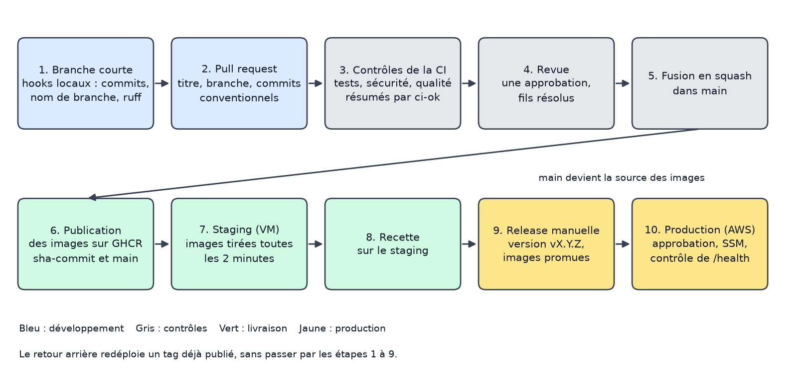

Dix étapes, de la branche courte à la production. Le retour arrière redéploie un tag déjà publié, sans repasser par les étapes 1 à 9.

### Contrôles d'une pull request

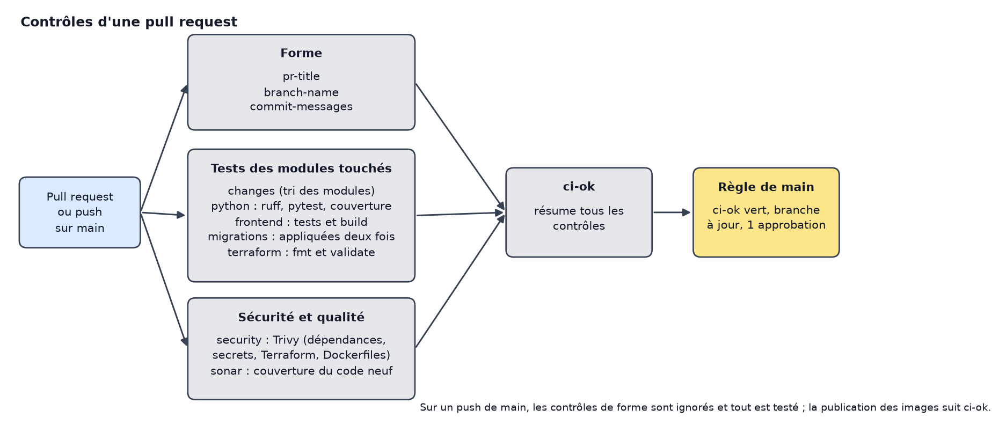

Contrôles de forme, tests des modules touchés, sécurité et qualité, tous résumés par `ci-ok`, que la règle de `main` exige. Détail : [contrôles de la CI](qualite-et-securite-ci.md).

### Environnements et circulation des images

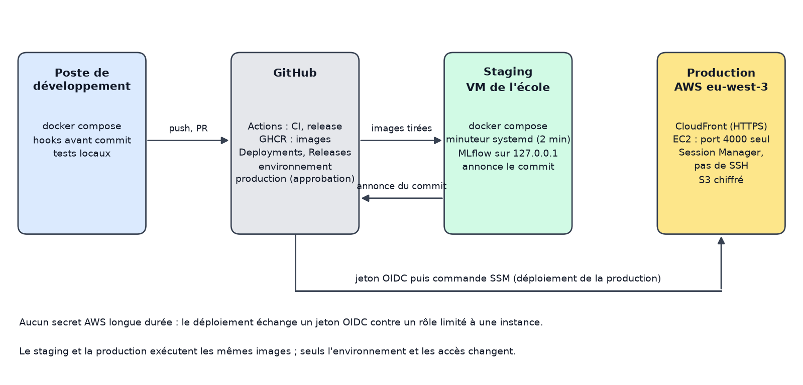

Du poste de développement à la production AWS en passant par GitHub et le staging. La production n'utilise aucun secret AWS de longue durée. Détail : [environnements techniques](environnements-techniques.md).

### Release et retour arrière

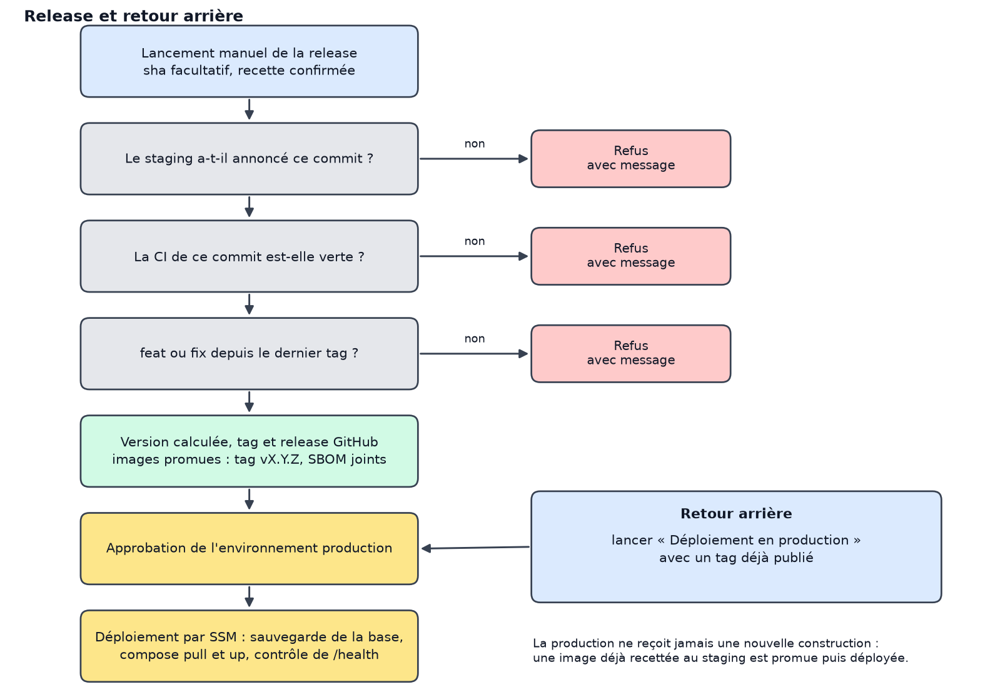

Trois vérifications avant toute release (commit annoncé par le staging, CI verte, au moins un `feat` ou un `fix`), puis approbation et déploiement. Procédure : [mise en production](mise-en-production.md).

### Des données au modèle

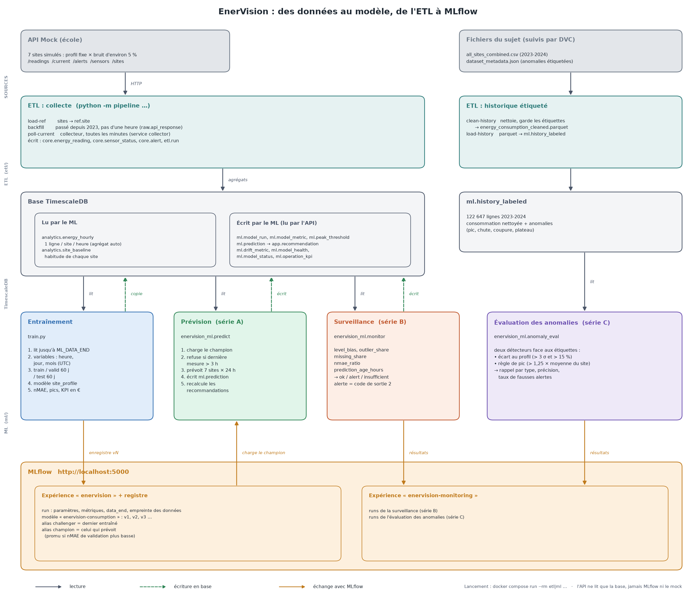

Des sources de l'ETL aux expériences MLflow, avec les tables lues et écrites par le ML.

## Base de données

### Schémas, tables et clés

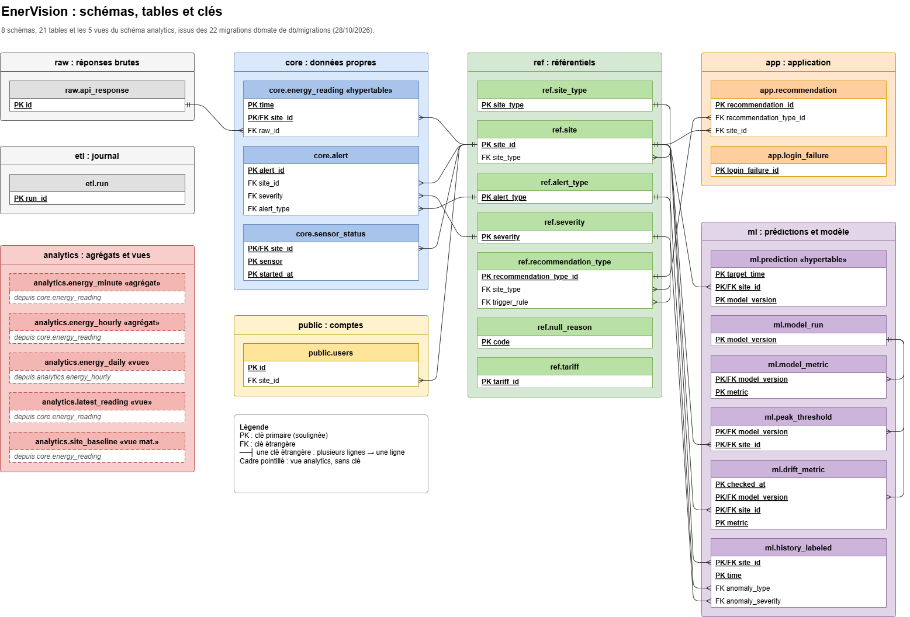

Huit schémas, 21 tables et 5 vues du schéma `analytics`, issus des migrations dbmate au 28/10. Les couleurs distinguent les données brutes, les mesures, les référentiels, l'application et le ML. Les migrations sont décrites dans [migrations de la base](migrations-base-de-donnees.md).

### Modèle détaillé

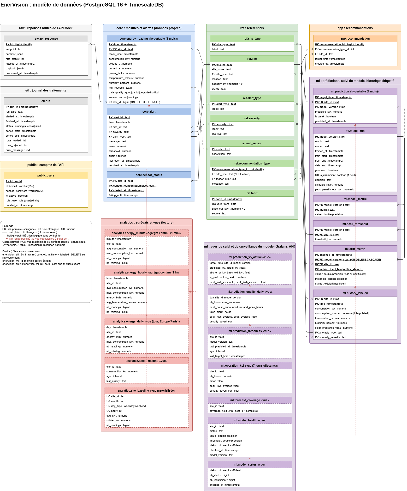

Les mêmes schémas avec toutes les colonnes, les droits de chaque rôle de base (sans connexion) et les vues de suivi du modèle lues par Grafana et l'API.

### Contenu des schémas

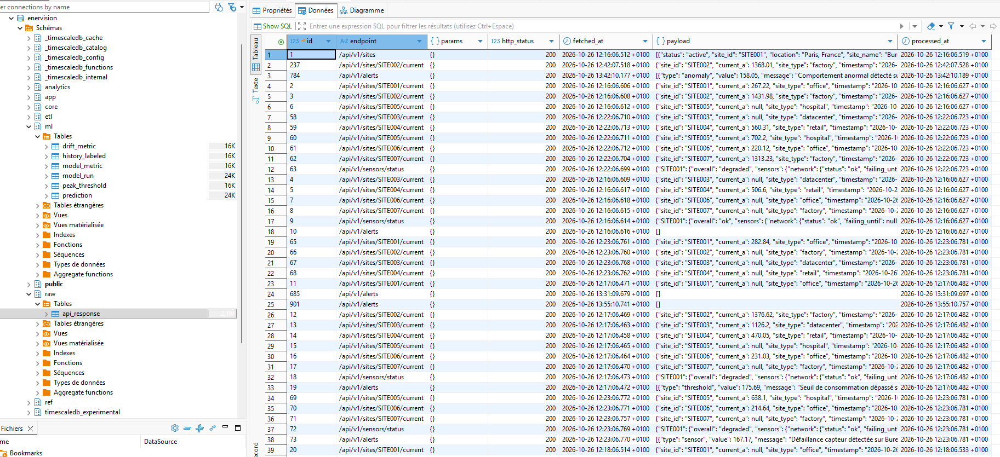

`raw.api_response` conserve chaque réponse de l'API Mock avec son point d'accès, son état HTTP, la date de collecte et le contenu JSON, avant toute transformation.

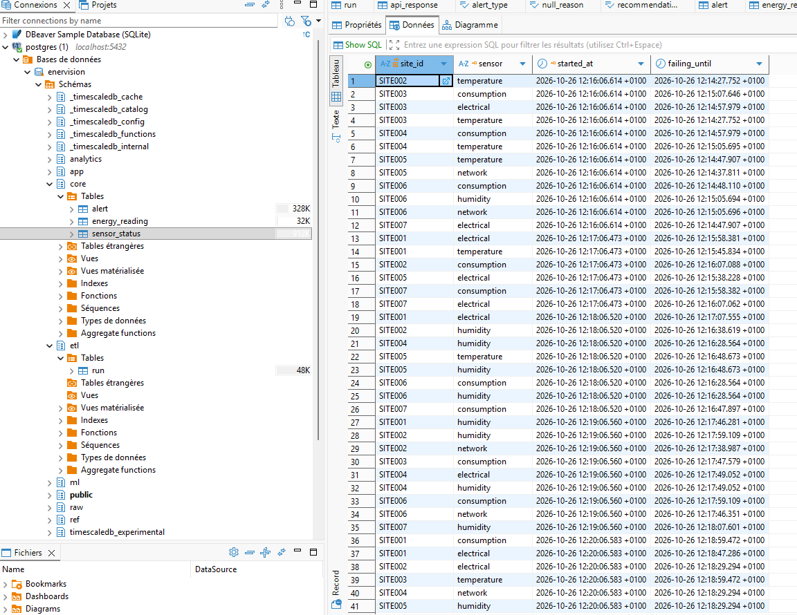

Dans `core`, `sensor_status` garde les pannes de capteurs (site, capteur, début, fin prévue), à côté des mesures et des alertes.

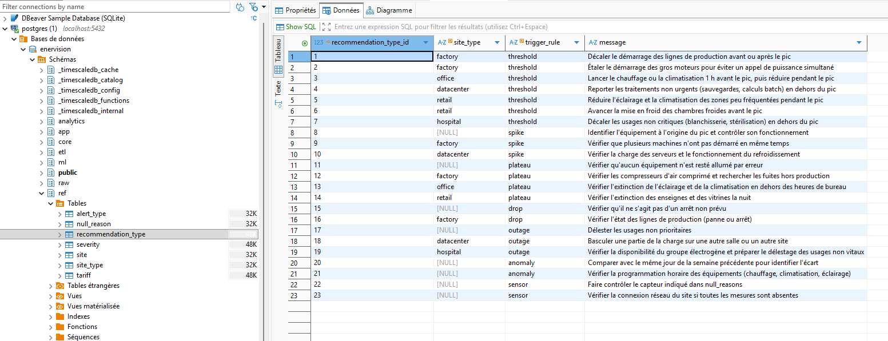

Dans `ref`, les référentiels : ici les 23 recommandations types, rattachées à un type de site et à une règle de déclenchement (seuil, pic, plateau, chute, coupure, anomalie, capteur).

## Livraison et suivi

### CI

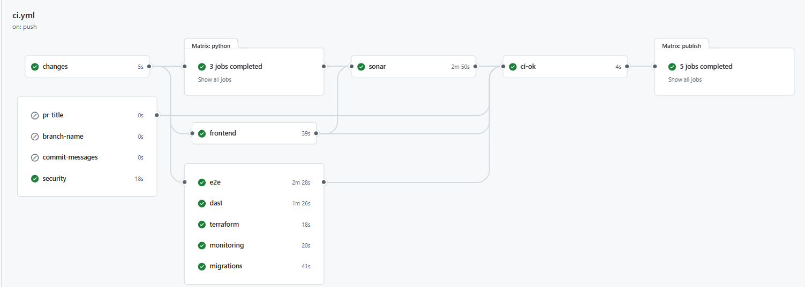

Une exécution complète de `ci.yml`. `changes` détecte les modules touchés, les contrôles utiles s'enchaînent, `ci-ok` regroupe le résultat exigé par la règle de `main`, puis `publish` construit les cinq images.

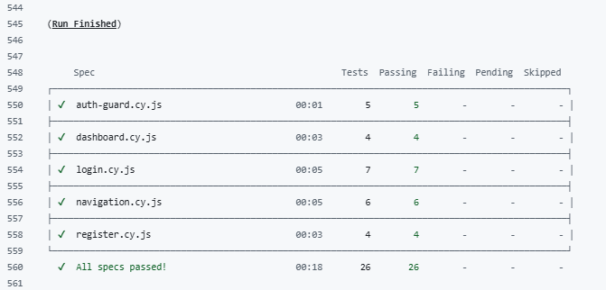

Fin du job `e2e` : cinq fichiers de scénarios (garde d'authentification, tableau de bord, connexion, navigation, inscription), 26 tests passés en 18 secondes.

### Kanban

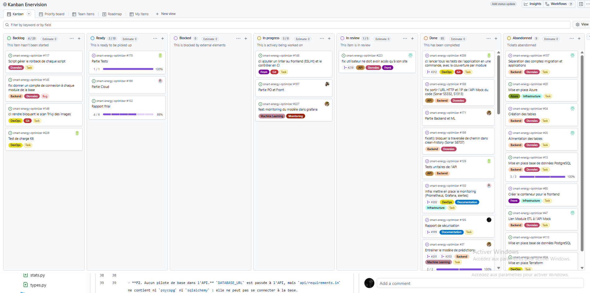

Le projet « Kanban Enervision » de l'organisation, de Backlog à Done, avec une colonne Abandonned. Les cartes sont les tickets du dépôt, étiquetés par module.

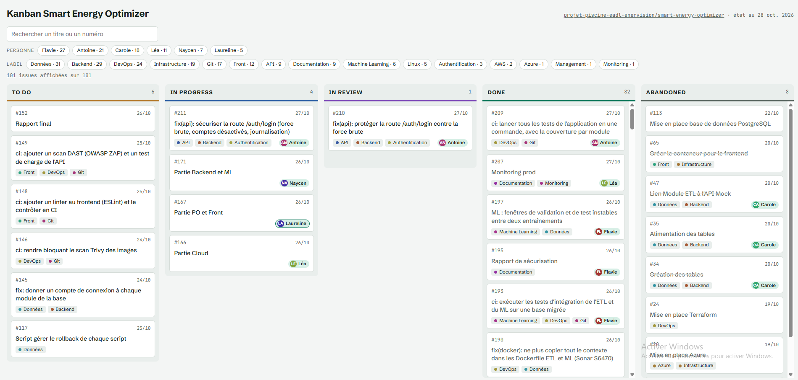

Vue exportée du même Kanban, avec les filtres par personne et par étiquette (état au 28/10).

### SonarQube Cloud

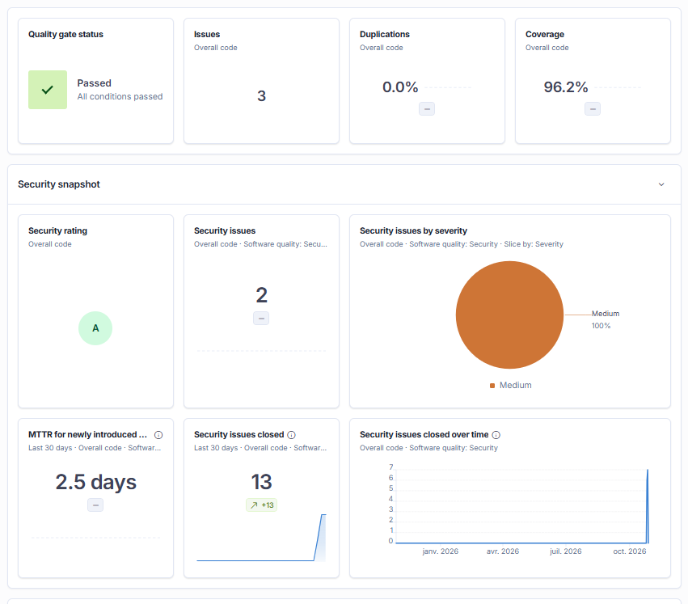

Synthèse du projet : porte de qualité passée, couverture de 96,2 % sur l'ensemble du code, 0 % de duplication, note de sécurité A, 13 problèmes de sécurité fermés sur 30 jours pour un délai de correction moyen de 2,5 jours.

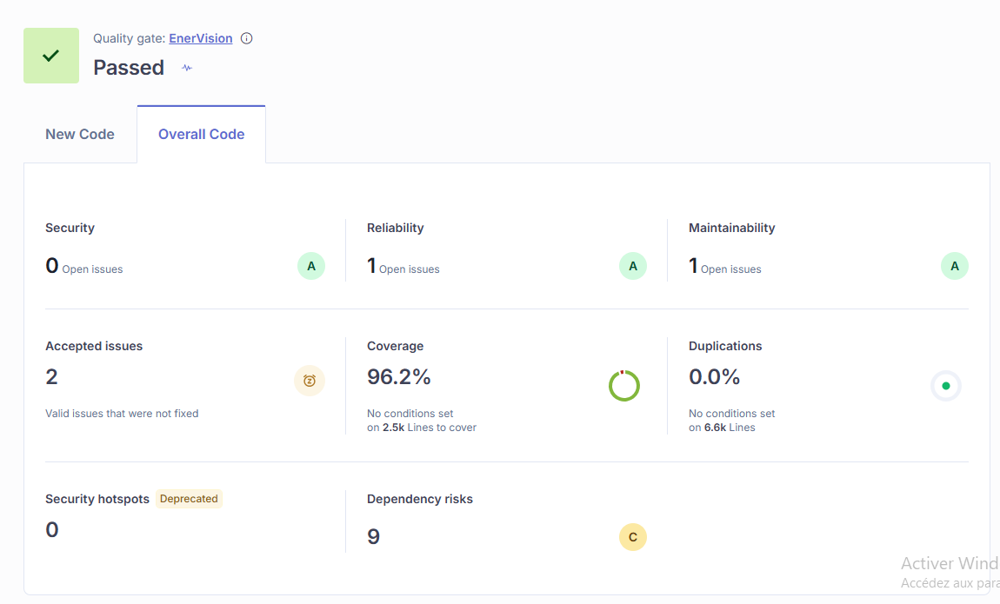

Onglet « Overall Code » : note A en sécurité, fiabilité et maintenabilité, 96,2 % de couverture sur 2,5 k lignes à couvrir, 0 % de duplication sur 6,6 k lignes, 9 risques de dépendances (note C).

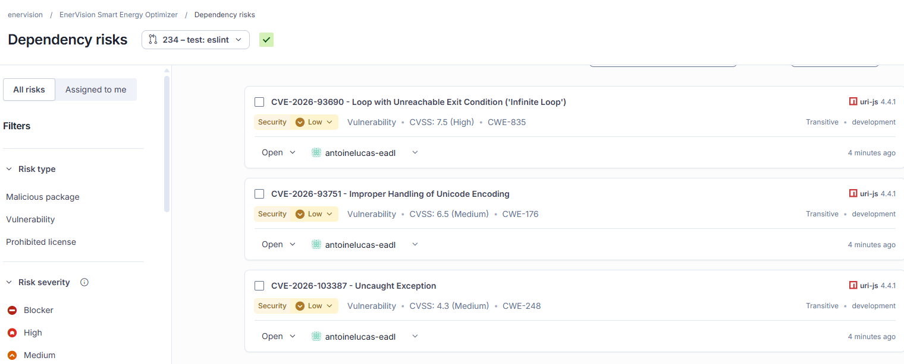

Vue « Dependency risks » d'une branche : chaque risque indique le paquet, la gravité, le score CVSS et le type de dépendance.

## Tests

### Tous les modules en une commande

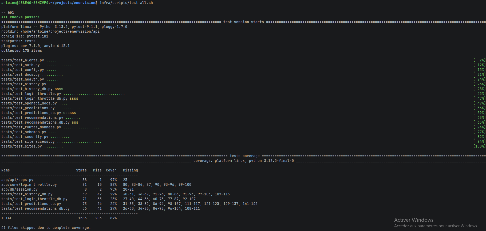

`infra/scripts/test-all.sh` lance ruff, les tests et la couverture de chaque module. Ici l'API : 175 tests collectés, couverture de 87 % ; les tests qui demandent une base réelle sont ignorés tant qu'elle n'est pas démarrée.

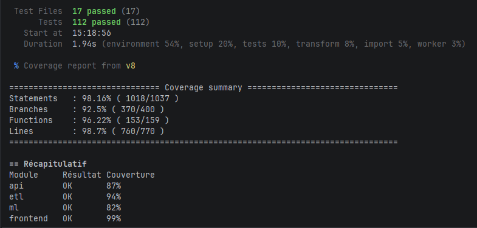

Fin de l'exécution : le frontend passe 112 tests en 17 fichiers (98 % des instructions couvertes), puis le récapitulatif par module : API 87 %, ETL 94 %, ML 82 %, frontend 99 %.

### Dépendances figées

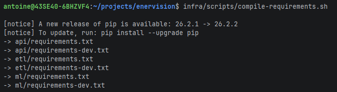

`infra/scripts/compile-requirements.sh` régénère les fichiers `requirements.txt` et `requirements-dev.txt` de l'API, de l'ETL et du ML.

## Développement local

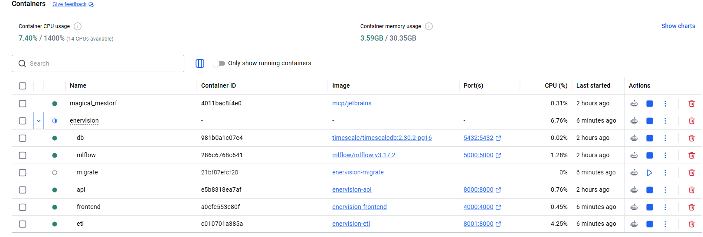

La pile locale dans Docker Desktop : base TimescaleDB, MLflow, `migrate` (qui s'arrête une fois les migrations appliquées), API, frontend et ETL.

## Wiki

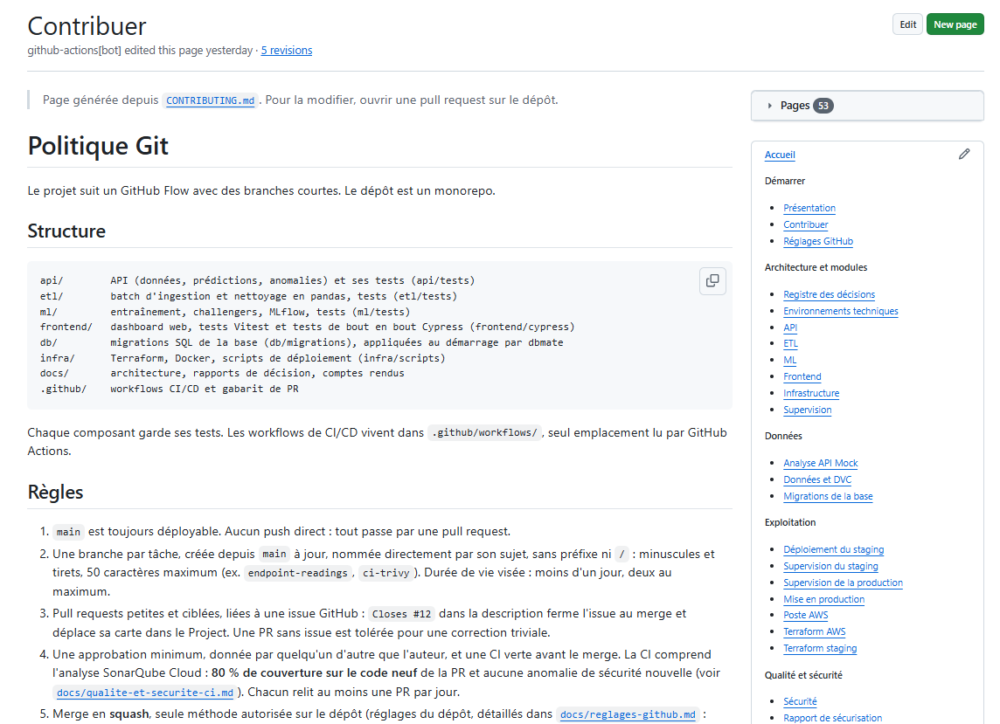

Une page générée depuis `CONTRIBUTING.md`, avec son bandeau d'origine et la barre latérale par sections. Mécanisme : `docs/wiki-map.toml` et `infra/scripts/sync-wiki.py`.

## Supervision

### Cibles de Prometheus

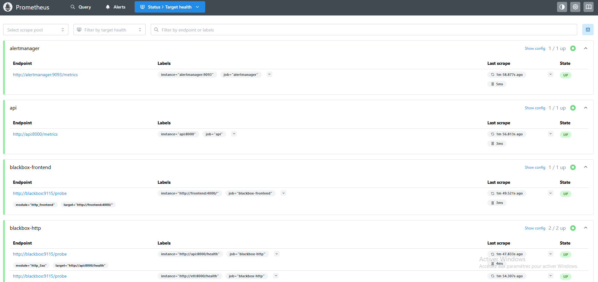

Page *Status > Target health* de Prometheus : chaque job collecté (Alertmanager, API, sondes du frontend, de l'API et de l'ETL…) est à l'état `UP`, avec la date de la dernière collecte et sa durée. Voir la [supervision](supervision-production.md) et [`monitoring/README.md`](../monitoring/README.md).

### Hôte

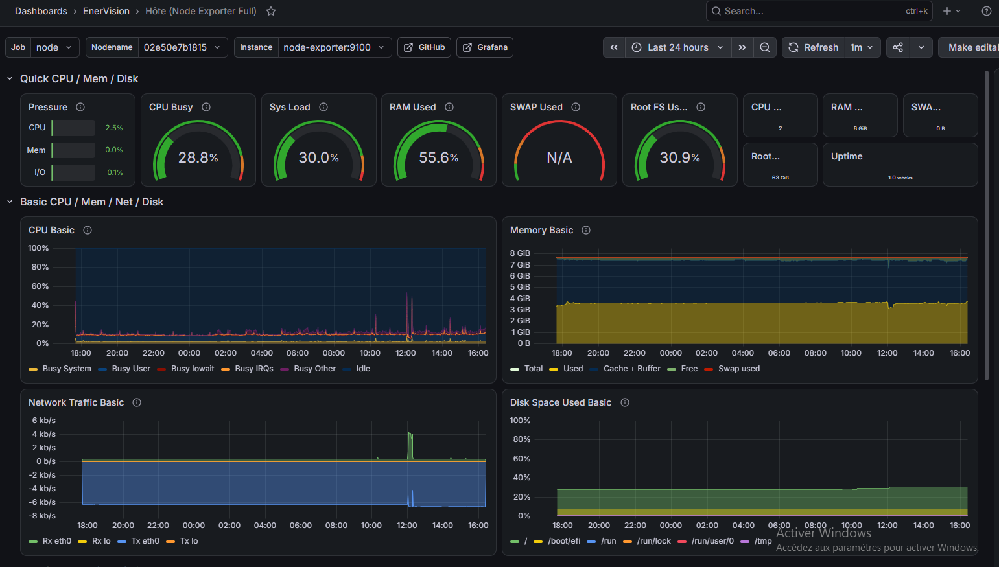

Dashboard « Hôte (Node Exporter Full) » sur 24 heures, pour l'instance de production (2 cœurs, 8 Gio de mémoire, disque de 63 Gio) : pression, charge CPU, mémoire, disque racine et réseau. Pas de swap, d'où la jauge `N/A`.

### Conteneurs

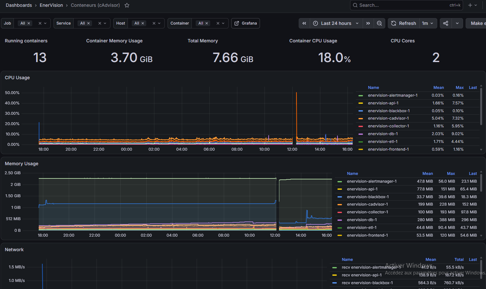

Dashboard « Conteneurs (cAdvisor) » : 13 conteneurs en marche, 3,70 Gio de mémoire utilisée sur 7,66 Gio, puis le CPU, la mémoire et le réseau de chaque conteneur sur 24 heures (base, API, ETL, collecteur, frontend, supervision).

### Base de données

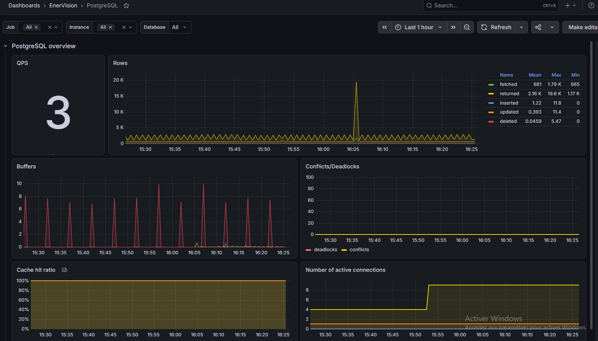

Dashboard « PostgreSQL » (postgres-exporter) sur une heure : requêtes par seconde, lignes lues, renvoyées, insérées, modifiées et supprimées, tampons, conflits et interblocages (aucun), taux de cache à 100 % et connexions actives.

### Sondes HTTP

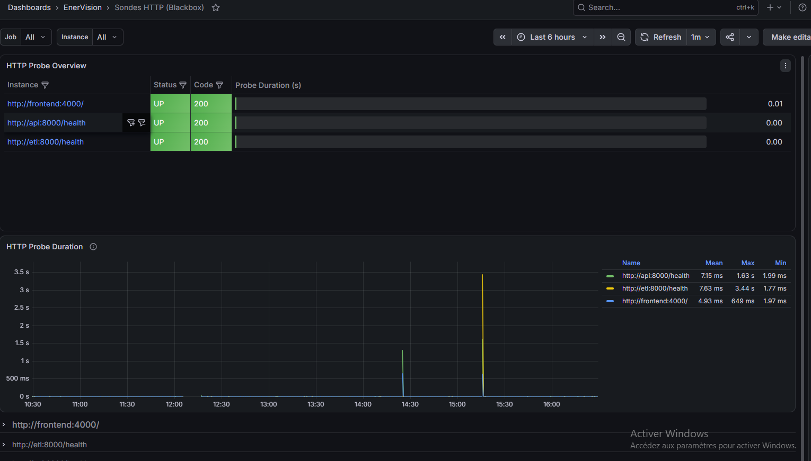

Dashboard « Sondes HTTP (Blackbox) » : le frontend et les `/health` de l'API et de l'ETL répondent `200` (`UP`), avec leur temps de réponse sur 6 heures, de l'ordre de quelques millisecondes en moyenne.

### Tâches planifiées

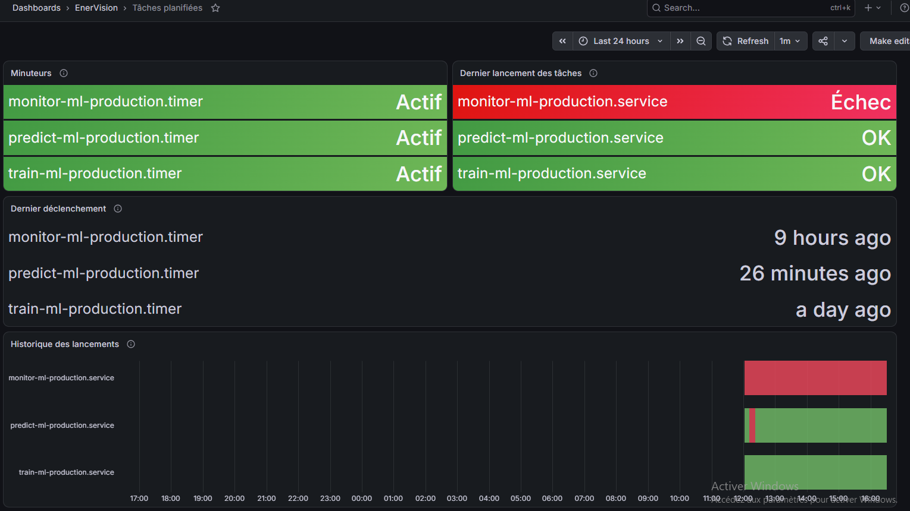

Dashboard « Tâches planifiées » en production : les trois minuteurs du module ML sont actifs ; le dernier lancement de `monitor-ml-production.service` est en échec (code 2 : dérive du modèle détectée), la prévision et l'entraînement sont `OK`. En dessous, le dernier déclenchement de chaque minuteur et l'historique des lancements.

### Alertes dans Teams

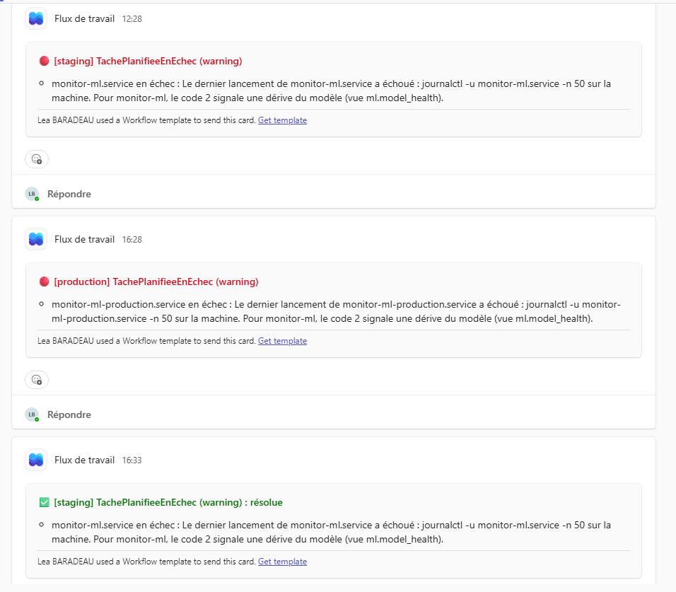

Le canal Teams des alertes, alimenté par Alertmanager : `TachePlanifieeEnEchec` sur la surveillance du modèle (`monitor-ml`), au staging puis en production, avec la commande à lancer et la signification du code 2 (dérive). Le message vert annonce la résolution de l'alerte du staging.

### CI et livraisons

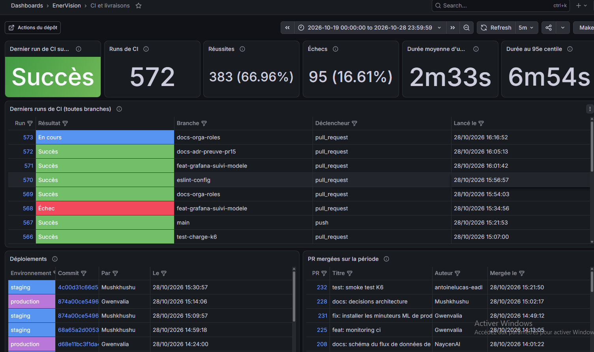

Dashboard « CI et livraisons », lu dans l'API GitHub, du 19 au 28/10 : 572 runs de CI, dont 383 réussis (67 %) et 95 en échec, pour une durée moyenne de 2 min 33 s ; les derniers runs par branche, les déploiements staging et production et les PR mergées.

### Modèle ML

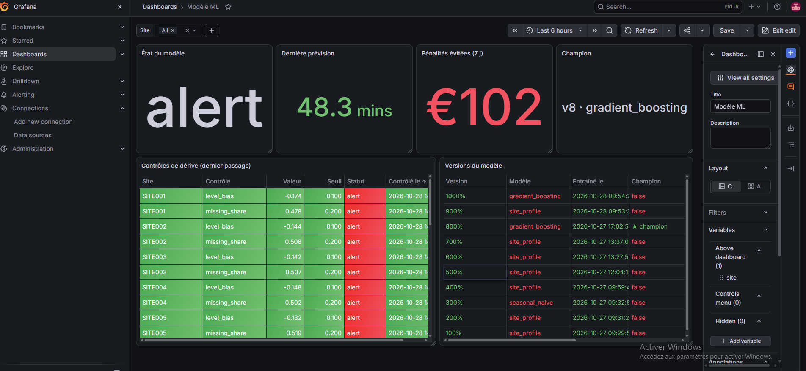

Dashboard « Modèle ML » : état du modèle, délai depuis la dernière prévision, pénalités évitées sur 7 jours, version championne, contrôles de dérive par site et versions entraînées. Voir la [supervision](supervision-production.md).

## Application

### Tableau de bord

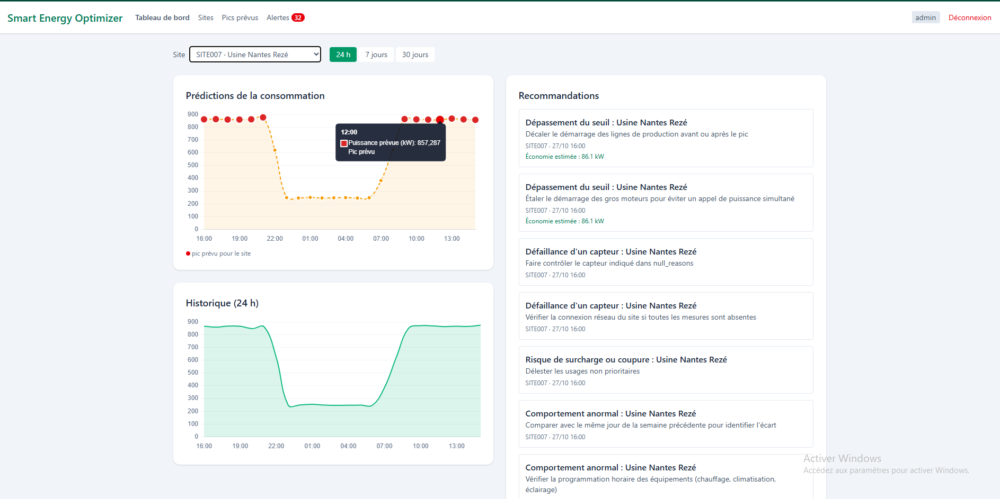

Pour un site : prévision des 24 prochaines heures avec les pics en rouge, historique des mesures et recommandations chiffrées.

### Pics prévus

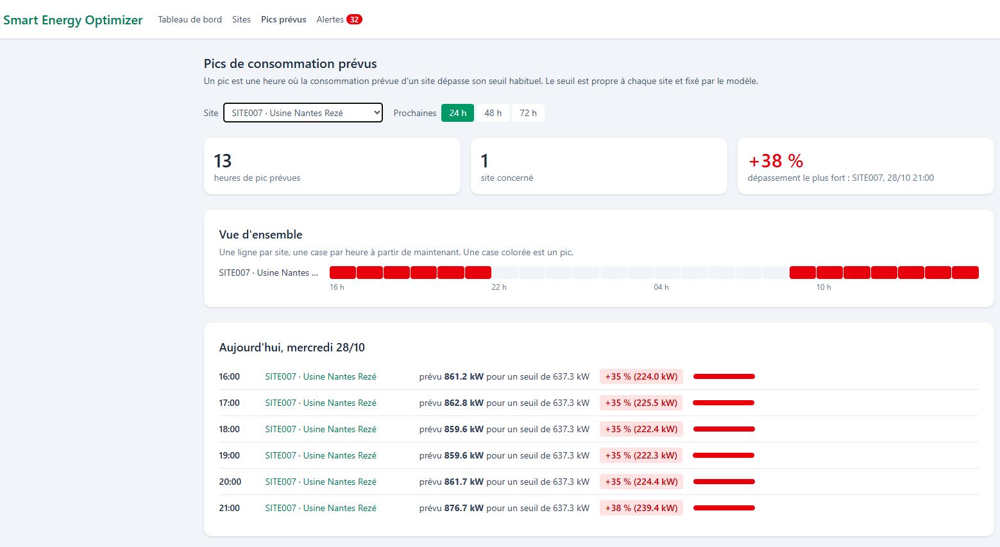

Les heures où la consommation prévue dépasse le seuil du site : synthèse en haut, une case par heure dans la vue d'ensemble, détail par jour en dessous.

### Alertes

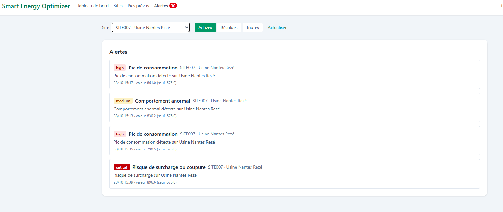

Alertes actives d'un site, classées par gravité (`medium`, `high`, `critical`), avec la valeur mesurée et le seuil.

## Cloud

### Console AWS

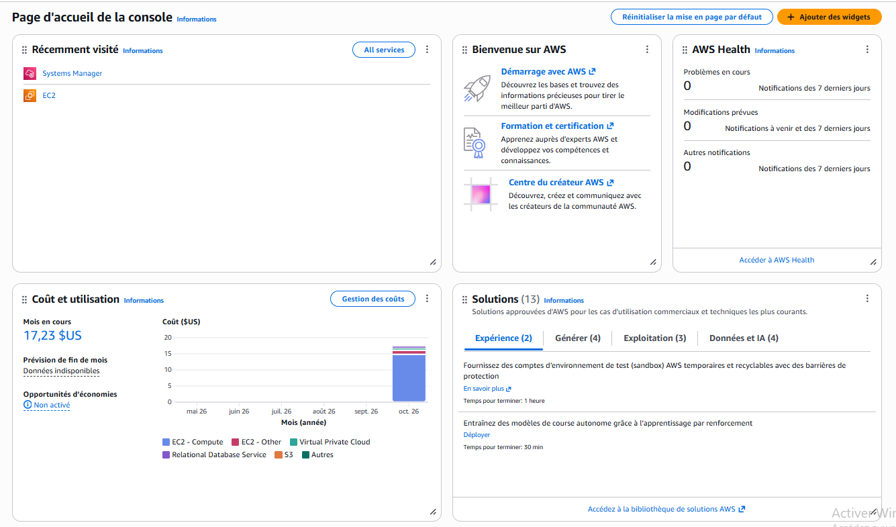

Accueil de la console du compte de production : services utilisés (EC2, Systems Manager) et coût du mois en cours, dominé par le calcul EC2.

### Instance EC2

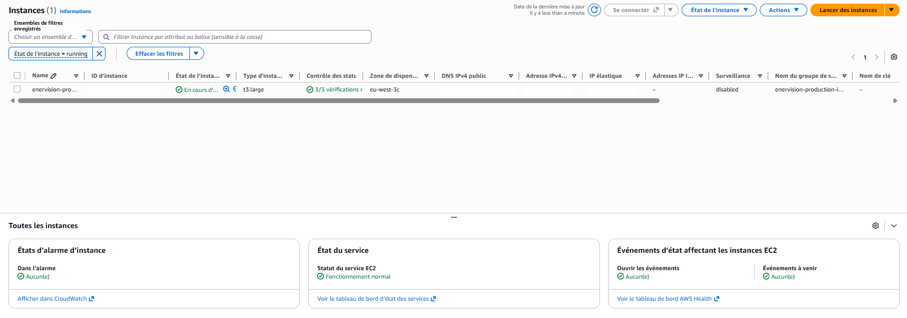

L'unique instance de production : `t3.large` en cours d'exécution, 3 vérifications sur 3 réussies, zone `eu-west-3c`, aucune alarme ni événement. Identifiant et adresses masqués.

### Stockage S3

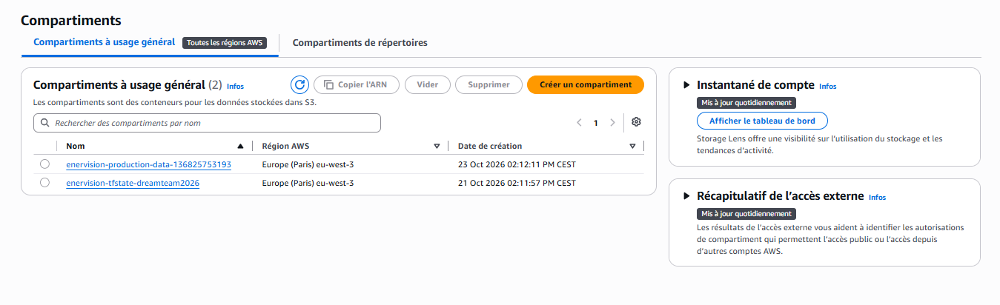

Deux compartiments en région Paris : les données de la production (remote DVC de production) et l'état Terraform. Voir [données et DVC](donnees-dvc.md).
