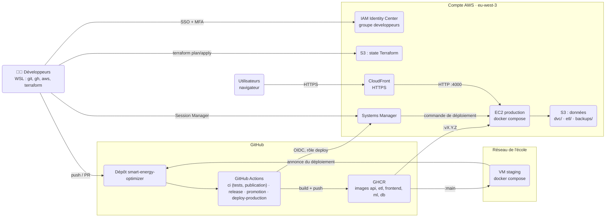
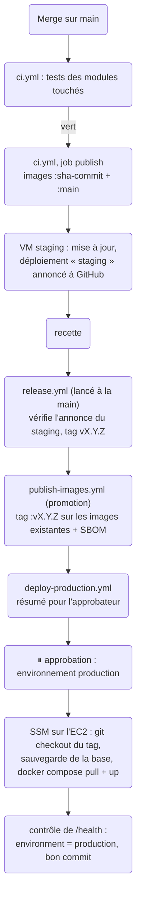

# Infrastructure : staging, production et livraison

Ce dossier décrit **où et comment tourne EnerVision** en dehors des postes de développement : le staging sur la VM de l'école, la production sur AWS, et ce qui relie les deux (images GHCR, GitHub Actions).

| Je veux… | Je lis… |
|---|---|
| obtenir mon accès AWS et préparer mon poste | [`docs/aws-poste-developpeur.md`](../docs/aws-poste-developpeur.md) |
| comprendre l'organisation d'ensemble | ce fichier |
| modifier l'infrastructure de production | [`infra/terraform/aws/README.md`](terraform/aws/README.md) |
| livrer une version ou revenir en arrière | [`docs/mise-en-production.md`](../docs/mise-en-production.md) |
| connaître les URLs, les services et les variables de chaque environnement | [`docs/environnements-techniques.md`](../docs/environnements-techniques.md) |
| lire les résultats de la CI (Trivy, Sonar) | [`docs/qualite-et-securite-ci.md`](../docs/qualite-et-securite-ci.md) |

## Deux environnements

| | Staging (preprod) | Production |
|---|---|---|
| Où | VM de l'école (`10.43.43.50`, réseau de l'école) | EC2 AWS, région `eu-west-3` (Paris) |
| Système | Debian 13 | Debian 13 (même image de base) |
| Lancement | `docker-compose.staging.yml` | le **même** `docker-compose.staging.yml` |
| Images | `ghcr.io/…/<module>:main` (dernier commit vert de `main`) | `ghcr.io/…/<module>:vX.Y.Z` (version recettée) |
| Configuration | `/etc/enervision/staging.env` | `/etc/enervision/production.env` |
| Mise à jour | automatique après chaque merge sur `main`, annoncée à GitHub | release, puis **approbation** dans GitHub |
| Accès | SSH sur le réseau de l'école | AWS Session Manager (pas de SSH) |
| URL | http://10.43.43.50:4000 (réseau de l'école) | https://dvrgizboitg9p.cloudfront.net |

Le principe : **ce qui part en production est exactement ce qui a été testé en staging**. Les images ne sont jamais reconstruites pour la prod, elles reçoivent seulement un tag de version.

## Vue d'ensemble



## Organisation du compte AWS

Un **compte AWS dédié au projet**, en région Paris (`eu-west-3`), financé par des crédits. Une alerte de budget prévient par e-mail en cas de dérive.

**Les humains** se connectent par **IAM Identity Center** (SSO) :

- un utilisateur par personne, avec mot de passe et **MFA obligatoire** ;
- tous dans le groupe `developpeurs`, qui a le rôle `AdministratorAccess` sur le compte ;
- sur le poste, un profil AWS local nommé `enervision` (`aws configure sso`), renouvelé par `aws sso login` quand la session expire ;
- le compte **root** n'est pas utilisé au quotidien (MFA activée, identifiants au coffre).

**Les machines** n'ont aucune clé AWS. Elles reçoivent des droits temporaires par un rôle IAM :

| Qui | Comment | Rôle | Ce qu'il peut faire |
|---|---|---|---|
| GitHub Actions | jeton **OIDC** de GitHub, environnement `production` uniquement | `enervision-production-deploy` | lancer une commande shell SSM **sur l'instance de prod** et lire son résultat. Rien d'autre. |
| L'EC2 | *instance profile* | `enervision-production-instance` | s'enregistrer auprès de Systems Manager (agent SSM) ; dans le bucket de données : lire et écrire `etl/` et `backups/`, lire `dvc/`, sans suppression |

Il n'y a donc **aucun secret AWS dans GitHub** ni sur les postes : seulement des sessions temporaires, liées à une personne ou à un job.

## Ce qui tourne sur AWS

| Élément | Géré par | Rôle |
|---|---|---|
| EC2 `t3.large` Debian 13, disque 64 Go chiffré | Terraform | fait tourner base, API, ETL et frontend dans Docker |
| IP Elastic | Terraform | adresse fixe de l'instance : CloudFront la joint par son nom DNS |
| CloudFront | Terraform | expose le site en **HTTPS** (`https://dvrgizboitg9p.cloudfront.net`), sans cache, et transmet à l'instance sur le port 4000 |
| Security group | Terraform | **une seule entrée** : le port 4000, depuis les seules adresses de CloudFront ; sortie 80/443 (GHCR, Debian, SSM, API mock) |
| Bucket S3 de données `enervision-production-data-<compte>` | Terraform | privé, chiffré ; préfixes `dvc/` (remote DVC de production), `etl/` et `backups/` (30 jours) |
| Rôles IAM instance et deploy, fournisseur OIDC GitHub | Terraform | voir le tableau ci-dessus |
| Bucket S3 `enervision-tfstate-dreamteam2026` | créé à la main, une fois | state Terraform partagé (versionné, privé, verrou) |
| IAM Identity Center, organisation, budget | console, une fois | accès des personnes, alerte de coût |

Seul le frontend est exposé : il transmet lui-même `/api/` à l'API. L'API (port 8000), l'ETL et la base restent fermés. Le détail des ressources, des variables et des pièges connus est dans [`terraform/aws/README.md`](terraform/aws/README.md).

## D'un commit à la production



Le **retour arrière** utilise le workflow de déploiement, lancé à la main avec un tag déjà publié. Procédure complète : [`docs/mise-en-production.md`](../docs/mise-en-production.md).

## Où sont les secrets

Aucun secret n'est dans le dépôt. Pour mémoire :

| Secret | Emplacement | Remarque |
|---|---|---|
| Variables de prod (mot de passe de la base, `SECRET_KEY`, identifiants de l'API mock…) | `/etc/enervision/production.env` sur l'EC2, droits `600 root` | créé à la main par Session Manager |
| Jeton de lecture GHCR (`read:packages`) | `/root/.docker/config.json` sur l'EC2 | jeton personnel, **avec une date d'expiration** : à renouveler s'il expire avant la fin |
| Jeton du staging (`/etc/enervision/github-deploy.token`) | sur la VM de staging, droits `600 root` | jeton à grain fin (Deployments, un dépôt), **avec une date d'expiration** : il sert à annoncer le staging à GitHub (voir `docs/deploiement-staging.md`) |
| `SONAR_TOKEN` | secret du dépôt GitHub | jeton d'analyse SonarQube Cloud, utilisé par la CI |
| State Terraform | bucket S3 privé | peut contenir des valeurs sensibles : jamais dans Git |
| `terraform.tfvars`, `backend.hcl` | sur le poste de chacun | non versionnés ; `backend.hcl.example` donne le modèle |

## Contenu du dossier

```
infra/
├── README.md                 ← ce fichier : vue d'ensemble
├── scripts/
│   ├── install-tools.sh      ← installe AWS CLI, Terraform et gh sur un poste (sans sudo)
│   ├── update-staging.*      ← mise à jour du staging (script, service et minuteur systemd)
│   ├── report-staging-deployment.sh  ← annonce à GitHub que le staging est à jour
│   ├── staging-deployment.sh ← lit cette annonce (utilisé par la release)
│   ├── setup-vm-roles.sh     ← comptes de service mlflow et monitoring sur la VM de staging
│   ├── changed-modules.sh    ← modules touchés par une PR (utilisé par la CI)
│   ├── prefix-coverage.py    ← rapports de couverture lisibles par Sonar
│   ├── compile-requirements.sh, check-*.sh  ← dépendances Python, contrôles de nom et de commit
│   └── test-*                ← tests de ces scripts, lancés par la CI
└── terraform/
    ├── aws/                  ← infrastructure de production
    │   ├── README.md         ← référence technique Terraform
    │   ├── versions.tf  variables.tf  main.tf  public.tf  s3.tf  outputs.tf
    │   ├── user_data.sh      ← premier démarrage de l'EC2 (Docker, agent SSM, clone)
    │   ├── backend.hcl.example
    │   └── terraform.tfvars.example
    └── staging/              ← note sur un Terraform du staging (non écrit)

docs/
├── aws-poste-developpeur.md  ← obtenir son accès AWS et préparer son poste
├── environnements-techniques.md  ← URLs, services et variables des trois environnements
├── mise-en-production.md     ← release, approbation, retour arrière
└── qualite-et-securite-ci.md ← contrôles de la CI, Trivy, Sonar

.github/workflows/
├── ci.yml                    ← tests, publication des images, analyse Sonar
├── publish-images.yml        ← promotion des images (tag de version, SBOM)
├── release.yml               ← release, puis promotion et déploiement
└── deploy-production.yml     ← déploiement en production et retour arrière
```

## Coûts et fin de projet

La production coûte environ **35 à 40 $ pour deux semaines** (EC2 `t3.large` allumée en continu, disque, IP Elastic). CloudFront (classe de prix la moins chère, sans cache), le bucket de données, Identity Center, les rôles IAM et le state S3 sont gratuits ou négligeables à ce volume.

À la fin du projet, tout se supprime : voir *Supprimer l'infrastructure* dans [`terraform/aws/README.md`](terraform/aws/README.md#supprimer-linfrastructure-fin-de-projet).
