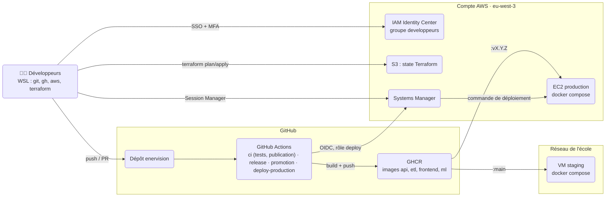
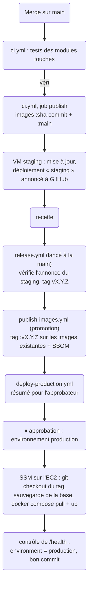

# EnerVision : accès AWS et poste développeur

Ce guide est à suivre **une seule fois**, dans l'ordre, pour obtenir ton accès au compte AWS
de l'équipe et préparer ta machine (WSL Debian ou Ubuntu). Compte environ 30 minutes.

Ce qui est **déjà fait** par l'admin (rien à refaire) :

- le compte AWS et ton utilisateur IAM Identity Center ;
- le bucket S3 qui stocke le state Terraform ;
- l'infrastructure de prod (`terraform apply`) : l'EC2 tourne déjà.

> ⚠️ Ne lance **jamais** les commandes `aws s3api create-bucket` du tuto, ni de
> `terraform apply` sans en avoir parlé à l'équipe.

## Infos dont tu as besoin

| Quoi | Valeur |
|---|---|
| AWS access portal URL | `https://d-806769cc86.awsapps.com/start` *(envoyée par Lea)* |
| Région | `eu-west-3` (Paris) |
| Nom du profil AWS | `enervision` |
| Bucket du state Terraform | `enervision-tfstate-dreamteam2026` |
| Dépôt GitHub | `projet-piscine-eadl-enervision/enervision` |

---

## 1. Activer ton compte AWS

1. Ouvre l'e-mail **« Invitation to join AWS IAM Identity Center »** (vérifie tes spams).
   Le lien **expire au bout de 7 jours** : si c'est trop tard, demande à Lea de te le renvoyer.
2. Clique sur **Accept invitation**, choisis ton mot de passe.
3. Enregistre la **double authentification (MFA)** :
   - choisis **Authenticator app** ;
   - scanne le QR code avec Google Authenticator, Authy, Microsoft Authenticator ou 1Password ;
   - saisis le code à 6 chiffres affiché.
4. Tu arrives sur le portail AWS : tu dois voir le compte du projet et le rôle
   **AdministratorAccess**. Clique dessus pour vérifier que la console s'ouvre.

Range ton mot de passe dans un gestionnaire de mots de passe, jamais dans un fichier ou
une messagerie.

## 2. Installer les outils (AWS CLI, Terraform, GitHub CLI)

Dans ton terminal WSL :

```bash
# Prérequis
sudo apt update && sudo apt install -y curl unzip python3 git

# Récupérer le dépôt (si ce n'est pas déjà fait)
mkdir -p ~/projects && cd ~/projects
git clone git@github.com:projet-piscine-eadl-enervision/enervision.git
cd enervision

# Installer les outils (sans sudo !)
infra/scripts/install-tools.sh
source ~/.bashrc
aws --version && terraform version && gh --version
```

Ce dossier décrit **où et comment tourne EnerVision** en dehors des postes de développement :
le staging sur la VM de l'école, la production sur AWS, et ce qui relie les deux (images
GHCR, GitHub Actions).

| Je veux… | Je lis… |
|---|---|
| obtenir mon accès AWS et préparer mon poste | [`docs/aws-poste-developpeur.md`](../docs/aws-poste-developpeur.md) |
| comprendre l'organisation d'ensemble | ce fichier |
| modifier l'infrastructure de production | [`infra/terraform/aws/README.md`](terraform/aws/README.md) |
| livrer une version ou revenir en arrière | [`docs/mise-en-production.md`](../docs/mise-en-production.md) |

## Deux environnements

| | Staging (preprod) | Production |
|---|---|---|
| Où | VM de l'école (`10.43.43.50`, réseau de l'école) | EC2 AWS, région `eu-west-3` (Paris) |
| Système | Debian 13 | Debian 13 (même image de base) |
| Lancement | `docker-compose.staging.yml` | le **même** `docker-compose.staging.yml` |
| Images | `ghcr.io/…/<module>:main` (dernier commit vert de `main`) | `ghcr.io/…/<module>:vX.Y.Z` (version recettée) |
| Configuration | `/etc/enervision/staging.env` | `/etc/enervision/production.env` |
| Mise à jour | automatique après chaque merge sur `main` | release + **approbation** dans GitHub |
| Accès | SSH sur le réseau de l'école | AWS Session Manager (pas de SSH) |

Le principe : **ce qui part en production est exactement ce qui a été testé en staging**. Les
images ne sont jamais reconstruites pour la prod, elles reçoivent seulement un tag de version.

## Vue d'ensemble



## Organisation du compte AWS

Un **compte AWS dédié au projet**, en région Paris (`eu-west-3`), financé par des crédits.
Une alerte de budget prévient par e-mail en cas de dérive.

**Les humains** se connectent par **IAM Identity Center** (SSO) :

- un utilisateur par personne, avec mot de passe et **MFA obligatoire** ;
- tous dans le groupe `developpeurs`, qui a le rôle `AdministratorAccess` sur le compte ;
- sur le poste, un profil AWS local nommé `enervision` (`aws configure sso`), renouvelé par
  `aws sso login` quand la session expire ;
- le compte **root** n'est pas utilisé au quotidien (MFA activée, identifiants au coffre).

**Les machines** n'ont aucune clé AWS. Elles reçoivent des droits temporaires par un rôle IAM :

| Qui | Comment | Rôle | Ce qu'il peut faire |
|---|---|---|---|
| GitHub Actions | jeton **OIDC** de GitHub, environnement `production` uniquement | `enervision-production-deploy` | lancer une commande shell SSM **sur l'instance de prod** et lire son résultat. Rien d'autre. |
| L'EC2 | *instance profile* | `enervision-production-instance` | s'enregistrer auprès de Systems Manager (agent SSM) |

Il n'y a donc **aucun secret AWS dans GitHub** ni sur les postes : seulement des sessions
temporaires, liées à une personne ou à un job.

## Ce qui tourne sur AWS

| Élément | Géré par | Rôle |
|---|---|---|
| EC2 `t3.large` Debian 13, disque 64 Go chiffré | Terraform | fait tourner base, API, ETL et frontend dans Docker |
| Security group | Terraform | **aucune entrée** ; sortie 80/443 seulement (GHCR, Debian, SSM, API mock) |
| Rôles IAM instance et deploy, fournisseur OIDC GitHub | Terraform | voir le tableau ci-dessus |
| Bucket S3 `enervision-tfstate-dreamteam2026` | créé à la main, une fois | state Terraform partagé (versionné, privé, verrou) |
| IAM Identity Center, organisation, budget | console, une fois | accès des personnes, alerte de coût |

Le détail des ressources, des variables et des pièges connus est dans
[`terraform/aws/README.md`](terraform/aws/README.md).

## D'un commit à la production



Le **retour arrière** utilise le même workflow, lancé à la main avec un tag déjà publié.
Procédure complète : [`docs/mise-en-production.md`](../docs/mise-en-production.md).

## Où sont les secrets

Aucun secret n'est dans le dépôt. Pour mémoire :

| Secret | Emplacement | Remarque |
|---|---|---|
| Variables de prod (mot de passe de la base, identifiants de l'API mock…) | `/etc/enervision/production.env` sur l'EC2, droits `600 root` | créé à la main par Session Manager |
| Jeton de lecture GHCR (`read:packages`) | `/root/.docker/config.json` sur l'EC2 | jeton personnel, **avec une date d'expiration** : à renouveler s'il expire avant la fin |
| Jeton du staging (`/etc/enervision/github-deploy.token`) | sur la VM de staging, droits `600 root` | jeton à grain fin (Deployments, un dépôt), **avec une date d'expiration** : il sert à annoncer le staging à GitHub (voir `docs/deploiement-staging.md`) |
| State Terraform | bucket S3 privé | peut contenir des valeurs sensibles : jamais dans Git |
| `terraform.tfvars`, `backend.hcl` | sur le poste de chacun | non versionnés, partagés en message privé |

## Contenu du dossier

```
infra/
├── README.md                 ← ce fichier : vue d'ensemble
├── scripts/
│   └── install-tools.sh      ← installe AWS CLI, Terraform et gh sur un poste (sans sudo)
└── terraform/
    └── aws/                  ← infrastructure de production
        ├── README.md         ← référence technique Terraform
        ├── versions.tf  variables.tf  main.tf  outputs.tf
        ├── user_data.sh      ← premier démarrage de l'EC2 (Docker, agent SSM, clone)
        ├── backend.hcl.example
        └── terraform.tfvars.example

docs/
├── aws-poste-developpeur.md  ← obtenir son accès AWS et préparer son poste
└── mise-en-production.md     ← release, approbation, retour arrière

.github/workflows/
├── ci.yml  publish-images.yml  release.yml  deploy-production.yml
```

## Coûts et fin de projet

La production coûte environ **35 à 40 $ pour deux semaines** (EC2 `t3.large` allumée en
continu, disque, IP publique). Le reste (Identity Center, rôles IAM, state S3) est gratuit ou
négligeable.

À la fin du projet, tout se supprime : voir *Supprimer l'infrastructure* dans
[`terraform/aws/README.md`](terraform/aws/README.md#supprimer-linfrastructure-fin-de-projet).
